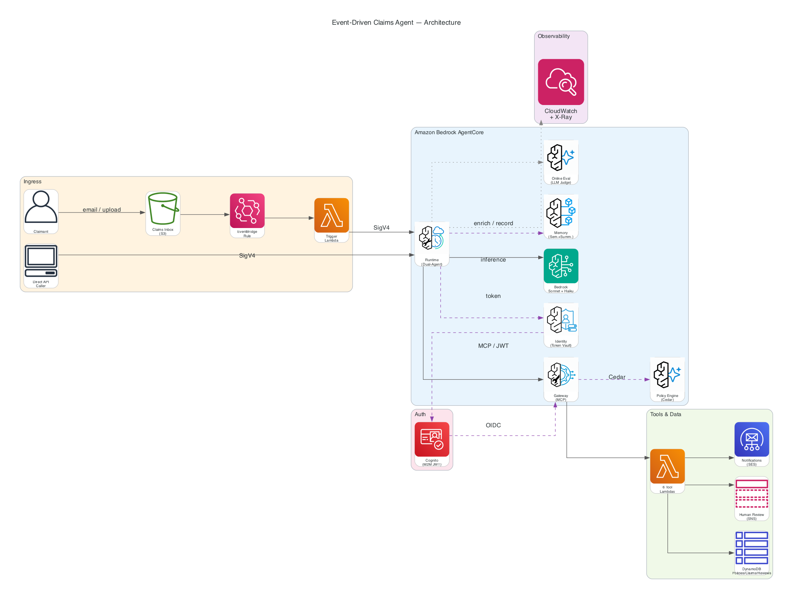

# Event-Driven Claims Processing Agent

> [!IMPORTANT]
> The examples provided in this repository are for experimental and educational purposes only. They demonstrate concepts and techniques but are not intended for direct use in production environments.

An event-driven insurance claims processing system built on **Amazon Bedrock AgentCore**. Claims arrive via email, are processed by a dual-agent architecture (Claims Processor + Validation Agent), and are automatically routed based on confidence scoring — all deployed with a single command.

| | |
|---|---|
| ⏱️ **Time to deploy** | ~20-30 minutes (first time, with prerequisites met) |
| 💰 **Running cost** | ~$3-5/day (Fargate + DynamoDB on-demand + Lambda). Tear down when not testing. |
| 🏗️ **Resources created** | ~76 (via single CloudFormation stack) |
| 🧹 **Teardown** | `./scripts/destroy.sh us-west-2` removes everything (stack + Cognito + state) |

## Three agent apps, and the rule-pack layer

`app/` holds three folders that are easy to confuse. The base `agentcore/agentcore.json` deploys one of them: the YAML port.

| Folder | What it is | Deployed? | How it is built |
|---|---|---|---|
| `app/claimsagent/` | The generic insurance claims demo this README describes: Claims Processor plus Validation Agent, confidence-based routing | No. A reference scaffold | Hand-written Python (`main.py`, about 540 lines) |
| `app/hesta-claimsagent/` | The pilot for an Australian super fund's member-email operations: a pipeline of specialist agents, a deterministic routing gate, nothing auto-sent | No longer. It was what `agentcore.json` deployed until 2026-10-25, and is now legacy | Hand-written Python (`main.py` about 390 lines, plus `agents/`) |
| `app/04_hesta_member_email/` | The same pilot rebuilt YAML-first on `strands-compose`: agents, prompts, models and delegation live in `config.yaml` | **Yes.** `agentcore/agentcore.json` points its runtime here. It has a Dockerfile and locked dependencies | `config.yaml` plus a small `hesta/` package of tools and the agent factory |

The two pilot apps are meant to behave the same. They are kept apart on purpose, and the conformance runner below
checks them against one feature file (it found a real disagreement between them).

### Rule packs: the plug-and-play layer

Business rules are not hard-coded in the apps. A **rule pack** is a folder: one plain-language `.feature` file, a
`vocabulary.yaml` that says what every word means, and two generated files (`manifest.json`, `compiled/policy.cedar`).
A deterministic compiler, with no LLM in it, turns the feature file and vocabulary into a Cedar policy. A fail-closed
loader then refuses any pack whose hashes, approval record or effective dates do not check out. The handler is built
from the verified policy text and attached to an agent as a Strands intervention.

| Path | What it is |
|---|---|
| `app/04_hesta_member_email/core/` | The **core**: client-neutral code that ships in every client's container. The rule-pack compiler and loader (`cedar_pack.py`), the Gherkin parser, the agent factory, the Gateway client, memory and generic settings. A test checks it names no client and works with only the app folder present |
| `app/04_hesta_member_email/hesta/` | The **client package**: HESTA's schemas, taxonomy, knowledge, ingestion, tools and thresholds, bound to the core through a thin factory |
| `rules/` | The command-line launcher for the compiler (`cedar_pack.py`), the conformance runner (`run_feature.py`, which still holds the first client's routing steps) and the feature files |
| `rules/packs/` | Two packs built before `clients/` existed: the super-fund tool boundary, and an **illustrative** health-insurer one that we wrote ourselves (not any insurer's rules) |
| `clients/` | One folder per client for their documents (`sources/`, gitignored) and their `pack/`. Copy `clients/_template/`. See `clients/README.md` |
| `demo/` | An offline, narrated demo ("same core, different rules") with a run sheet, presenter notes and a transcript |

A client's pack is **not part of the framework by design**: each client plugs in its own. The loader that checks a pack does
ship with the app, in `core/`. The agent finds a pack through the `CEDAR_PACK_DIR` setting, which is empty (off) by default.

```bash
python3 rules/cedar_pack.py compile clients/<name>/pack   # build manifest + Cedar policy
python3 rules/cedar_pack.py check   clients/<name>/pack   # tamper, approval and date checks
python3 rules/run_feature.py rules/hesta_routing_gate.feature   # run a feature file against the routing code
bash demo/setup.sh && demo/.venv/bin/python demo/run_demo.py     # the demo (needs uv; see demo/RUN-SHEET.md)
```

**Status: draft.** Be clear about what this is not yet:
- No pack is approved, and approvals are unsigned JSON, so they can be forged.
- The Cedar handler is wired into `app/04_hesta_member_email/`, which the base spec now deploys, but it is off by default (`CEDAR_PACK_DIR` is empty) and attached only to `human_handoff`. The legacy app, `app/hesta-claimsagent/`, does not use it.
- A client's pack is copied into its image when the project is assembled and is only switched on if it verifies; nothing here has been deployed to AWS. The loader ships inside the app, in `core/`.
- A rule can be scoped to one agent (`for the agent "X"`), so several agents can share a pack and each is judged as itself. Only `human_handoff` is wired to a pack today, and an agent that carries one is refused every tool its vocabulary does not list, local tools included. Memory is opened only for a verified member in the YAML port, but the legacy app still keys it on the email text before checking identity. Effective dates are checked against today, not the case date.
- The Gateway's own Cedar policies (below) still apply. The pack check is an additional, earlier layer, not a replacement.

### Deploying a client: one project per client

`python3 scripts/assemble_client.py <client> [--display-name "…"] [--profile presale] [--pack-dir …] [--enable-pack]` builds
`build/<client>/` (git-ignored): its own `agentcore.json` (project, memory and credential names for that client; **placeholders for
its Cognito identity, never another environment's**), the CDK app set to that client, the core and client package with the client's
pack copied in, and the Lambdas. Two clients in one AWS account then share no physical name, and each gets a key of its own for its
tables, inbox bucket, review topic and queue. `--enable-pack` is refused unless the pack verifies.

What has been **proved offline** (no AWS credentials were used): the image builds for arm64 and answers `/ping`, runs as a non-root
user and loads all ten agents inside the container; both assembled projects pass `agentcore validate`; and two assembled clients
synthesised into one account and region share no physical name. What has **not** been done: any deploy.

`deploy.sh`, `destroy.sh` and the scripts take `--client <slug>` and then act on `build/<slug>` only: its own stack, credential
provider, Cognito pool and `.env`. With no client they behave as before, with the original names. `--plan` prints every name a
script would use and stops before any AWS call, so check it first:

```bash
./deploy.sh ap-southeast-2 --client acme --plan      # names only, nothing changed
./deploy.sh ap-southeast-2 --client acme             # Cognito, credential, deploy, seed
./scripts/destroy.sh ap-southeast-2 --client acme    # that client's stack, credential and Cognito pool only
```

Proved offline: `--plan` for every script (with an `aws` that fails if called), the original names unchanged, two clients sharing no
name, and refusal of a project that belongs to another client (`tests/test_client_scripts.py`). Not proved: a run against AWS.
A client's teardown skips the name-matching sweep of leftover AgentCore resources unless you add `--sweep-orphans`.

## What You'll Learn

This sample teaches you how to build a production-realistic agent system on AgentCore. By the time you've deployed and explored it, you'll understand:

| Concept | What it demonstrates |
|---------|---------------------|
| **Dual-agent orchestration** | Two Strands agents in sequence — a Claims Processor makes a decision, then a Validation Agent independently reviews it to reduce bias |
| **Event-driven triggers** | S3 → EventBridge → Lambda → AgentCore Runtime pipeline for asynchronous processing |
| **MCP Gateway + Lambda tools** | Tools deployed as Lambda functions behind the Model Context Protocol Gateway, discoverable via semantic search |
| **Cedar policy enforcement** | A Policy Engine that blocks tool calls at runtime (e.g., claims ≥$100k are denied before execution) |
| **AgentCore Identity for auth** | `@requires_access_token` decorator manages OAuth tokens via Identity vault — no secrets in env vars |
| **Agent memory** | SEMANTIC + SUMMARIZATION strategies for cross-session recall of repeat claimants |
| **Online evaluation** | Built-in quality metrics (Helpfulness, Correctness, Tool Selection Accuracy) running on every invocation |
| **Full observability automation** | CloudWatch Transaction Search + TRACES/LOGS delivery for Gateway/Memory enabled via scripts |

## Architecture



<details>
<summary>Text description (for accessibility)</summary>

The system has three layers:

1. **Ingress:** Email → Amazon SES → S3 bucket (claims-inbox/) → EventBridge rule → Trigger Lambda (SigV4 auth to Runtime)
2. **Processing:** AgentCore Runtime runs Phase 1 (Claims Processor), Phase 2 (Validation Agent), Phase 3 (Execution based on confidence score)
3. **Tools:** MCP Gateway (Cognito CUSTOM_JWT auth) + Cedar Policy Engine routes tool calls to 6 Lambda functions → DynamoDB, SNS, and SES

</details>

See [docs/ARCHITECTURE.md](./docs/ARCHITECTURE.md) for full component diagrams, data flows, and details.

## Quick Start

### Prerequisites

- AWS Account with [Bedrock model access](https://docs.aws.amazon.com/bedrock/latest/userguide/model-access.html) (Claude Sonnet 4)
- [AgentCore CLI](https://docs.aws.amazon.com/bedrock/latest/userguide/agentcore.html) (`npm install -g @aws/bedrock-agentcore-cli`, ≥ 1.0.0-preview.13)
- [AWS CDK CLI](https://docs.aws.amazon.com/cdk/v2/guide/getting-started.html) (`npm install -g aws-cdk`)
- [Docker](https://www.docker.com/products/docker-desktop/) or [Finch](https://github.com/runfinch/finch) (container runtime)
- Python 3.12+ with [uv](https://docs.astral.sh/uv/getting-started/installation/) (`pip install uv` or `brew install uv`)
- [AWS CLI v2](https://docs.aws.amazon.com/cli/latest/userguide/getting-started-install.html) configured (`aws configure`)
- Node.js 18+

### Deploy

> This quick start is the original single-client flow for the claims demo. To deploy for a client, use the assembled project
> described under "Deploying a client" above.

```bash
cd event-driven-claims-agent
./deploy.sh us-west-2
```

This single command: configures your target account/region → installs dependencies → validates `agentcore.json` → bootstraps CDK → deploys all 76 resources → seeds test data → prints test commands.

### Test

```bash
python3 scripts/test_invoke.py --region us-west-2
```

Expected output:

```
🔑 Authenticating...
✅ Connected to claimsagent
📝 I need to file a claim. My policy is POL-12345. Fender bender yesterday, $2000 damage.

━━━ Agent Response ━━━

## Phase 1: Claims Processing
[Agent looks up policy POL-12345, verifies coverage, makes ACCEPT decision]

---
## Phase 2: Validation & Routing
CONFIDENCE: 92
ROUTING: AUTO_APPROVE
[Validator confirms decision is sound — clear-cut case]

---
## Phase 3: Execution
**Auto-approved** (confidence: 92/100)
✅ Claim created: CLM-XXXXXXXX
📧 Approval notification sent to claimant@example.com

✅ Processing complete.

━━━━━━━━━━━━━━━━━━━━━
```

Try different scenarios:

```bash
# Cedar blocks this (≥$100k threshold)
python3 scripts/test_invoke.py --region us-west-2 \
  --prompt 'File a claim for POL-12345. Car totaled. $150000 damage.'

# Routes to human review (vague description → low confidence)
python3 scripts/test_invoke.py --region us-west-2 \
  --prompt 'Policy POL-12345. Something happened to my car.'

# Run all 5 E2E scenarios
python3 scripts/test_e2e.py --region us-west-2

# Validate the authentication patterns (SigV4 inbound, JWT rejection, Gateway M2M, negative cases)
python3 scripts/test_auth.py --region us-west-2
```

### Teardown

```bash
./scripts/destroy.sh us-west-2
```

## Demo

<p align="center">
  
</p>

The demo shows: (1) auto-approved claim with email notification, (2) Cedar policy blocking a $150k claim, (3) event-driven S3 → EventBridge → Agent flow.

## Documentation

| Document | What it covers |
|----------|----------------|
| [Architecture](./docs/ARCHITECTURE.md) | System components, data flows, dual-agent pipeline, Mermaid diagrams |
| [Deployment Guide](./docs/deployment.md) | Prerequisites, step-by-step deploy, verify, local dev, troubleshooting, teardown |
| [Configuration Reference](./docs/CONFIGURATION.md) | All env vars, Cedar policies, Cognito, SES, model, memory settings |
| [Tutorial: Make It Your Own](./docs/tutorial.md) | Guided walkthrough to modify the sample for your own use case |
| [Clients](./clients/README.md) | How to start a client: where their documents and rule pack go |
| [Demo run sheet](./demo/RUN-SHEET.md) | What the demo shows, what is real and what is mocked, and what is not done |

## AgentCore Services Demonstrated

| Service | What it does here |
|---------|-------------------|
| **Runtime** | Hosts the dual-agent container (Strands SDK, SigV4 inbound auth, streaming responses) |
| **Gateway** | MCP protocol for tool discovery + invocation, 6 Lambda targets, semantic search |
| **Identity** | Manages OAuth credentials for Runtime → Gateway auth (no secrets in env vars) |
| **Policy Engine** | Cedar policies enforced before every tool call (`AllowAll` + `BlockExcessiveClaims`) |
| **Memory** | SEMANTIC retrieval + SUMMARIZATION for repeat claimant recall across sessions |
| **Observability** | X-Ray tracing + CloudWatch APPLICATION_LOGS + Transaction Search with TRACES/LOGS delivery |
| **Evaluation** | 3 built-in metrics at 100% sampling + custom LLM-as-judge evaluator |

## Project Structure

```
event-driven-claims-agent/
├── app/
│   ├── hesta-claimsagent/     # Legacy: the original hand-written pilot (no longer what agentcore.json deploys)
│   ├── 04_hesta_member_email/ # The pilot, YAML-first (strands-compose): what the base agentcore.json deploys
│   └── claimsagent/           # Generic insurance demo this README describes. Reference, not deployed
│       ├── main.py            # Entrypoint: prompts, agents, routing, Identity-managed Gateway OAuth
│       ├── config.py          # Centralized env var reads
│       ├── Dockerfile         # Container image (Python 3.12, multi-stage)
│       ├── memory/session.py  # AgentCore Memory (graceful degradation)
│       └── tools/             # Co-located tools (structured output)
├── agentcore/
│   ├── agentcore.json         # AgentCore resources (Runtime, Gateway, Memory, PolicyEngine, Eval)
│   └── cdk/lib/               # CDK: supplementary infra (DynamoDB, S3, Lambda, EventBridge — NO Cognito)
├── lambdas/                   # One Lambda per Gateway tool
│   ├── schemas/               # MCP tool schemas (JSON)
│   ├── trigger/               # EventBridge → Runtime invocation (SigV4 auth)
│   ├── create_claim/          # DynamoDB write
│   ├── policy_lookup/         # DynamoDB read
│   ├── human_review/          # SNS + DynamoDB
│   ├── notification/          # SES email
│   ├── list_pending_claims/   # DynamoDB scan
│   └── resolve_claim/         # DynamoDB update
├── scripts/                   # Deploy + test + Cognito + observability utilities
│   ├── setup_cognito.sh       # Create Cognito User Pool (AWS CLI, not CDK)
│   ├── teardown_cognito.sh    # Delete Cognito if script-created
│   ├── enable_observability.py  # Enable Transaction Search + deliveries
│   ├── disable_observability.py # Clean up observability deliveries
│   ├── destroy.sh             # Unified teardown: observability → stack → Cognito → state
│   ├── test_invoke.py         # Interactive agent invocation (SigV4 auth, streaming)
│   ├── test_auth.py           # Authentication pattern tests (SigV4, JWT rejection, Gateway M2M)
│   ├── test_cedar.py          # Cedar policy enforcement tests
│   ├── test_e2e.py            # 5-scenario E2E test suite
│   └── seed_dynamodb.py       # Populate test policies
├── rules/                     # Rule-pack core: compiler, loader, conformance runner, packs
├── clients/                   # One folder per client: sources/ and pack/ (copy _template/)
├── demo/                      # Offline narrated demo, run sheet, presenter notes
├── tests/                     # Offline unit tests
├── docs/                      # Full documentation set
├── deploy.sh                  # One-command deploy (interactive Cognito setup)
└── README.md                  # This file
```

## Customization

### Change the AI model

Edit `agentcore/agentcore.json` → `runtimes[0].envVars`, change `AGENT_MODEL_ID`:
```json
{ "name": "AGENT_MODEL_ID", "value": "us.anthropic.claude-haiku-4-5-20251001-v1:0" }
```
Then: `agentcore deploy --target dev --yes`

### Adjust the Cedar policy threshold

The $100k blocking threshold is in `agentcore/agentcore.json` → `policyEngines[0].policies[1].statement`. Change `100000` to your value, then redeploy.

### Adjust the auto-approve confidence threshold

In `app/claimsagent/main.py`, search for `confidence >= 80`. Change `80` to your desired threshold.

### Add a new tool

See the step-by-step guide in [docs/tutorial.md](./docs/tutorial.md#experiment-5-add-a-new-tool).

### Adapt to a different domain

See the domain adaptation walkthrough in [docs/tutorial.md](./docs/tutorial.md#adapt-to-a-different-domain).

## 🤝 Contributing

We welcome contributions! Please see our [Contributing Guidelines](../../../CONTRIBUTING.md) for details.

## 📄 License

This project is licensed under the MIT License - see the [LICENSE](../../../LICENSE) file for details.

## 🆘 Support

- **Issues**: [GitHub Issues](https://github.com/awslabs/amazon-bedrock-agentcore-samples/issues)
- **AgentCore Docs**: [Amazon Bedrock AgentCore Documentation](https://docs.aws.amazon.com/bedrock/latest/userguide/agentcore.html)
- **Architecture & Decisions**: [docs/ARCHITECTURE.md](./docs/ARCHITECTURE.md) and [docs/decisions/](./docs/decisions/README.md)
