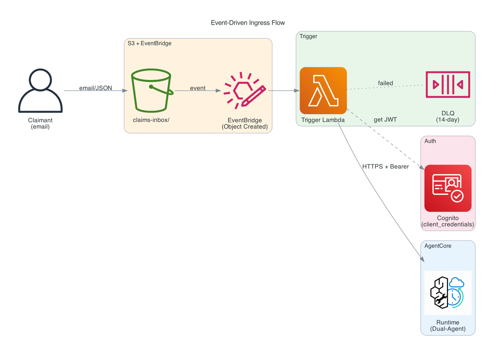
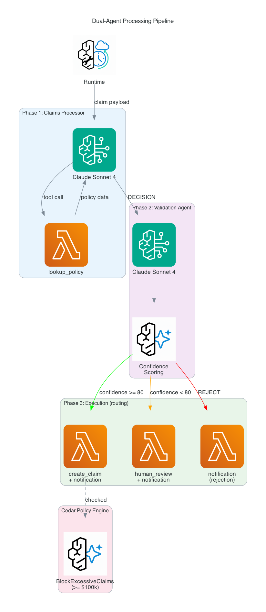
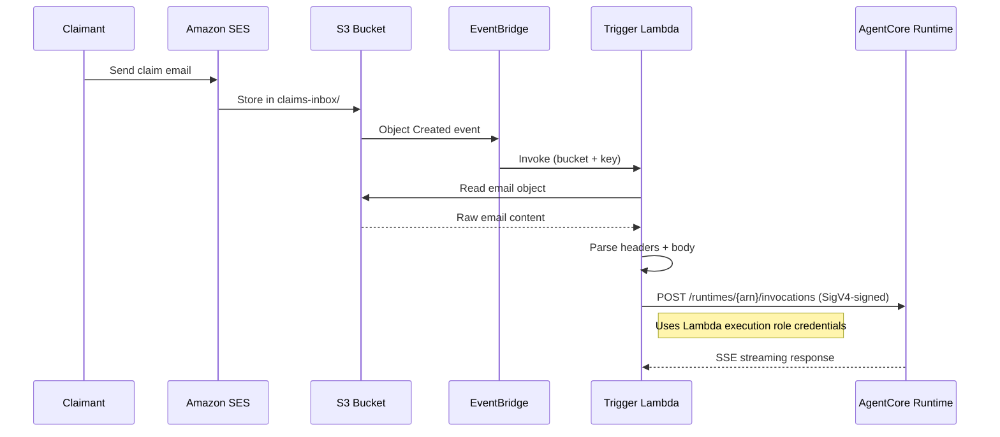
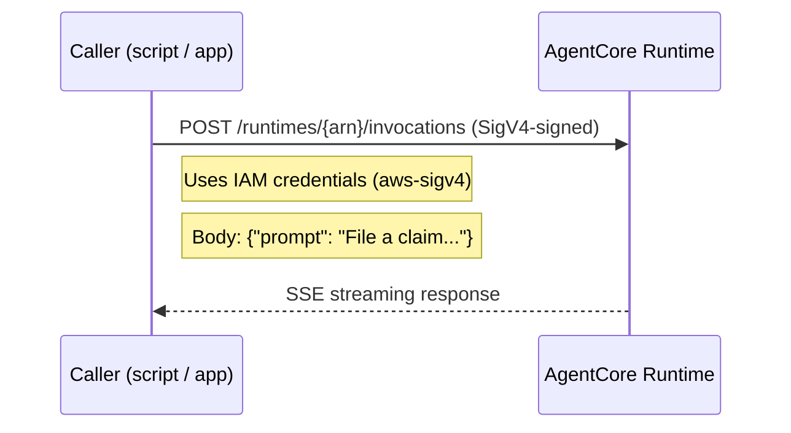
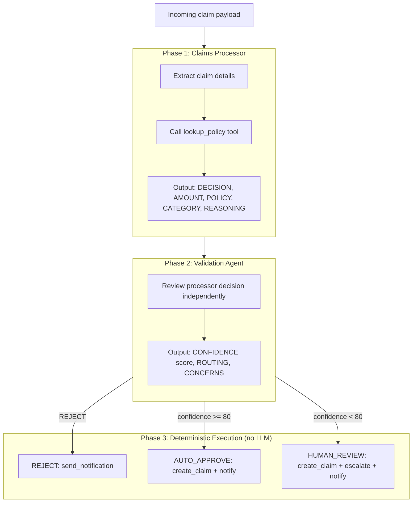
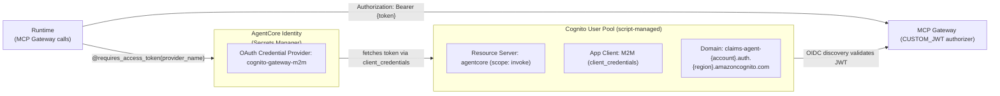

# Architecture: Event-Driven Claims Agent

## System Overview

The Event-Driven Claims Agent is an insurance claims processor built on Amazon Bedrock AgentCore. It accepts claim submissions via email (through S3/EventBridge) or direct API invocation, processes them through a dual-agent pipeline, and routes outcomes to auto-approval or human review.

For the framework itself — use-case folders, the envelope, blueprint tools and the
build step — see [FRAMEWORK.md](FRAMEWORK.md).

This document explains:
- **Components** — what each piece does and how they connect
- **Data flows** — how a claim moves from submission to resolution
- **Authentication** — how services authenticate to each other (Cognito M2M, JWT)
- **Tool architecture** — how the agent calls Lambda tools via the MCP Gateway
- **Memory and evaluation** — how the system remembers and monitors quality

## Architecture Diagrams

### High-Level Architecture


### Event-Driven Ingress Flow



### Dual-Agent Processing Pipeline



---

## Component Descriptions

### AgentCore Runtime

- **Build type:** Container (ARM64/Graviton, Python 3.12)
- **Framework:** Strands Agents SDK, composed from YAML with strands-compose (`strands-compose-agentcore`)
- **Auth (inbound):** AWS_IAM (SigV4) — callers sign requests with AWS credentials (Lambda execution role or IAM user)
- **Auth (outbound to Gateway):** Cognito M2M JWT via `@requires_access_token` decorator — secrets managed by AgentCore Identity vault (no env vars)
- **Entrypoint:** `app/main.py` — `create_app(app/<USE_CASE>/config.yaml)`; this document describes `USE_CASE = "claims_agent"` (see [SWITCHING_USE_CASES.md](../SWITCHING_USE_CASES.md))
- **Agents:** defined in `app/claims_agent/config.yaml` — `claims_processor`, `claims_validator`, and a `coordinator` that drives them through a delegate orchestration; built per session by `app/_shared/factory.py`
- **Model (cost routing):** Claims Processor uses `AGENT_MODEL_ID` (`global.anthropic.claude-sonnet-4-6`, complex reasoning + tool use); Validation Agent and coordinator use `FAST_MODEL_ID` (Haiku) — classification / sequencing, ~5x cheaper and faster
- **Structured output:** `ClaimDecision` / `ClaimValidation` Pydantic contracts (`app/claims_agent/schemas.py`)
- **Co-located tool:** `execute_claim_decision` (`app/claims_agent/tools.py`) — deterministic Phase 3

### AgentCore Gateway

- **Protocol:** MCP (Model Context Protocol) over streamable HTTP
- **Auth:** Cognito CUSTOM_JWT (validates JWT tokens via OIDC discovery URL from Cognito User Pool)
- **Search type:** SEMANTIC (tool discovery by description)
- **Targets:** 6 Lambda functions (see tool table below)
- **Policy enforcement:** Cedar Policy Engine runs before every tool call (ENFORCE mode)

### Cedar Policy Engine

Two policies are enforced at the Gateway level:

| Policy | Effect | Condition |
|--------|--------|-----------|
| `AllowAllTools` | permit | Any authenticated principal, any tool, on this gateway |
| `BlockExcessiveClaims` | forbid | `create-claim` when `context.input.estimated_amount >= 100000` |

Policy Engine operates in `ENFORCE` mode — blocked tool calls return an authorization error to the agent.

### Lambda Tool Functions

| Tool | Lambda (`AgentCore-ClaimsAgent-dev-…`) | Kind | DynamoDB | Notes |
|------|--------|------|----------|-------|
| `lookup_policy` | `policy-lookup` | blueprint `retrieval` | PoliciesTable (read) | Returns only the listed fields, or `found: false` + error |
| `create_claim` | `create-claim` | blueprint `record_write` | ClaimsTable (write) | Find-or-create on policy number + source; agent passes `status` + `decision` |
| `request_human_review` | `human-review` | blueprint `record_write` | ReviewsTable (write) | Derived priority; also publishes to SNS |
| `send_notification` | `notification` | custom | — | SES send email |
| `list_pending_claims` | `list-pending-claims` | blueprint `retrieval` (list) | ClaimsTable (status-index) | Filters `status=pending_review` |
| `resolve_claim` | `resolve-claim` | custom | ClaimsTable + ReviewsTable (update) | Human operator resolves |

Tools are declared in `app/<use_case>/gateway_tools.yaml` and built by `scripts/build_tools.py` — see [FRAMEWORK.md](FRAMEWORK.md#4-gateway-tools-blueprints-and-custom-tools). All handlers return `json.dumps({...})` directly — no HTTP envelope.

### Trigger Lambda

Handles the event-driven path from S3 → Runtime (fire-and-forget):
1. Receives EventBridge event with S3 object details
2. Reads the file from S3 (email format or raw JSON)
3. Parses email headers to extract `claimant_email` and `subject`
4. Signs the request with SigV4 using the Lambda's execution role credentials (IAM auth)
5. Invokes the Runtime via HTTPS POST to `/runtimes/{arn}/invocations`
6. Confirms HTTP 200 and reads first few lines to verify the agent started streaming
7. Closes the connection immediately — does NOT wait for the full response

The agent processes the claim asynchronously after the Lambda returns. Results are written to DynamoDB by the agent's tool calls (`create_claim`, `request_human_review`, `send_notification`), not returned to this Lambda.

**Auth:** The Trigger Lambda uses AWS_IAM (SigV4) authentication. CDK grants `bedrock-agentcore:InvokeAgentRuntime` permission via `runtime.grantInvoke(triggerFn)`. No Cognito credentials needed for this path.

---

## Data Flows

### Event-Driven Path (Email → S3 → EventBridge → Agent)



### Direct Invocation Path (API → Agent)



---

## Dual-Agent Processing Pipeline



### Routing Logic

The routing logic lives in `app/claims_agent/routing.py` (pure Python, unit-tested in `tests/test_routing.py`). The confidence threshold is configurable via the `AUTO_APPROVE_THRESHOLD` environment variable (default: 80); an AUTO_APPROVE below it is overridden to HUMAN_REVIEW.

If a structured result is missing, routing defaults to safe outcomes:
- Missing decision → defaults to REJECT (no unintended approvals)
- Missing validation → defaults to HUMAN_REVIEW (ensures human oversight)

### Phase 3: Deterministic Execution

No LLM picks the Phase 3 tools. The coordinator calls `execute_claim_decision` once with the structured Phase 1/2 results; the tool resolves routing (REJECT / AUTO_APPROVE / HUMAN_REVIEW) and calls Gateway tools directly via `MCPClient.call_tool_async()`.

All Phase 3 tool calls are non-fatal: if any fails, the agent logs a warning and continues. The primary response stream is never interrupted by secondary action failures.

---

## Memory Strategy

- **SEMANTIC** — stores and retrieves facts about claims and policies across sessions
- **SUMMARIZATION** — compresses session history for repeat claimants
- Expiration: 90 days
- Graceful degradation: if Memory is not deployed or throws `ResourceNotFoundException`, the agent continues without memory (no crash)

---

## Observability

- **X-Ray tracing:** enabled on the Runtime via `instrumentation.enableOtel: true`
- **CloudWatch logs:** `APPLICATION_LOGS` → `/aws/bedrock-agentcore/claims-agent` (1-week retention)
- **Transaction Search + Trace/Log Delivery:** Automatically enabled by `scripts/enable_observability.py` for Gateway and Memory
- **Online Evaluation:** 3 built-in metrics (Helpfulness, Correctness, Tool Selection Accuracy) at 100% sampling, bound to the Runtime endpoint
- **Automatic OTEL configuration:** Runtime auto-configures exporters, propagators, and instrumentation when `enableOtel: true` is set

---

## Cognito Authentication Architecture



### Auth Summary

| Path | Method | Mechanism |
|------|--------|-----------|
| Trigger Lambda → Runtime | AWS_IAM (SigV4) | Lambda execution role signs request with `bedrock-agentcore` service |
| Test scripts → Runtime | AWS_IAM (SigV4) | User/role credentials sign request with `bedrock-agentcore` service |
| Runtime → MCP Gateway | Cognito M2M JWT | `@requires_access_token` decorator → Identity vault → `client_credentials` flow → `Authorization: Bearer {token}` |
| Gateway → Lambda tools | IAM invoke | Gateway role has `lambda:InvokeFunction` on each tool function |

The Cognito User Pool is managed by `scripts/setup_cognito.sh` (creates) and `scripts/teardown_cognito.sh` (destroys). The client secret is registered with AgentCore Identity during deploy via `agentcore add credential`. All callers of the Runtime (Trigger Lambda, test scripts) use IAM auth (SigV4). CDK grants invoke permissions via `runtime.grantInvoke()`.

### Validating Authentication

`scripts/test_auth.py` exercises all four paths plus negative cases against a deployed stack:

```bash
python3 scripts/test_auth.py --region us-west-2
```

| # | Test | Expected |
|---|------|----------|
| 1 | SigV4 → Runtime | ✅ Accepted (correct inbound path) |
| 2 | JWT → Runtime | ❌ Rejected (Runtime is AWS_IAM inbound, not CUSTOM_JWT) |
| 3 | Runtime → Gateway (M2M) | ✅ Tool call succeeds (Identity-managed token) |
| 4 | No auth → Runtime | ❌ Rejected |
| 5 | Invalid JWT → Runtime | ❌ Rejected |
| 6 | Wrong scope → Cognito | ❌ Rejected at token endpoint |
