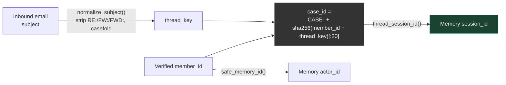
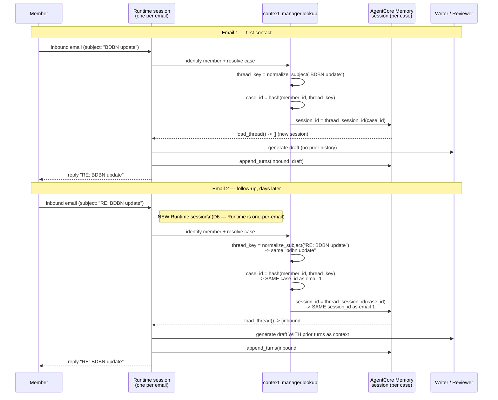

# Session Continuity: How a Follow-Up Email Resumes Context

Companion diagram for [ADR-0015](../decisions/0015-subject-threaded-cases-memory-conversation.md).
Summarizes how the AgentCore **Memory** session id is derived and reused across a case's whole
email thread, independent of the one-per-email AgentCore **Runtime** session.

## 1. Deriving the Memory session id from the email

Because `case_id` is a deterministic hash of `member_id` + normalized subject, **any email on the
same topic from the same member — first contact or the tenth follow-up — resolves to the same
`case_id`, and therefore the same Memory `session_id`.** No stateful lookup or reply-header
tracking is needed; a reply's subject is enough (which is why every draft's subject is set in
code as `RE: <original subject>`, never left to the Writer LLM).

## 2. Two emails, one Memory session

## Key point: two different "session" concepts

| | **Runtime session** | **Memory session** |
|---|---|---|
| Scope | One per inbound email | One per case (member + subject) — reused for the case's whole life |
| Id source | `runtimeSessionId` on `InvokeAgentRuntime` | `thread_session_id(case_id)` |
| Why separate | AgentCore Evaluation expects exactly one `invoke_agent` span per Runtime session; a Runtime session is a short-lived microVM (idle/max-lifetime limits), while follow-ups can arrive days later | Needs to outlive a single invocation and be re-derivable from any later email on the same thread |
| Code | `main.py` (`invoke` entrypoint) | [`memory/session.py`](../../app/hesta-claimsagent/memory/session.py) (`thread_session_id`, `append_turns`, `load_thread`) |

## Where this happens in code

1. [`ingestion/email_normalizer.py`](../../app/hesta-claimsagent/ingestion/email_normalizer.py) — `normalize_subject()` builds `thread_key` from the inbound subject.
2. `case_lookup_creation` Lambda — derives the deterministic `case_id` from `member_id` + `thread_key`.
3. [`memory/session.py`](../../app/hesta-claimsagent/memory/session.py) — `thread_session_id(case_id)` maps the case id to a Memory-safe `session_id`; `safe_memory_id(member_id)` maps to `actor_id`.
4. [`main.py`](../../app/hesta-claimsagent/main.py) `_run_pipeline` — on every inbound email, once identity + case resolve: derives `session_id`, calls `load_thread(actor_id, session_id)` for prior context, passes it into `context_manager.summarize`, then calls `append_turns(...)` after the draft is generated to record the new turns onto the same session for the *next* follow-up.
